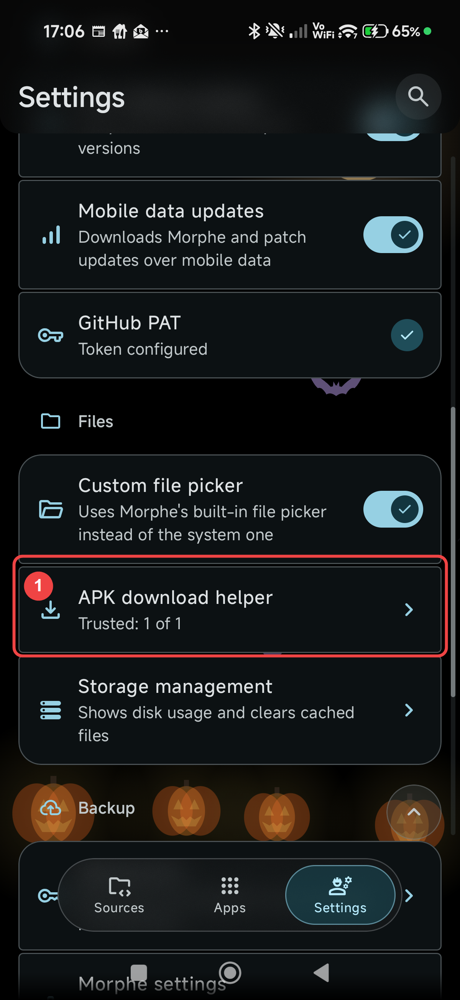
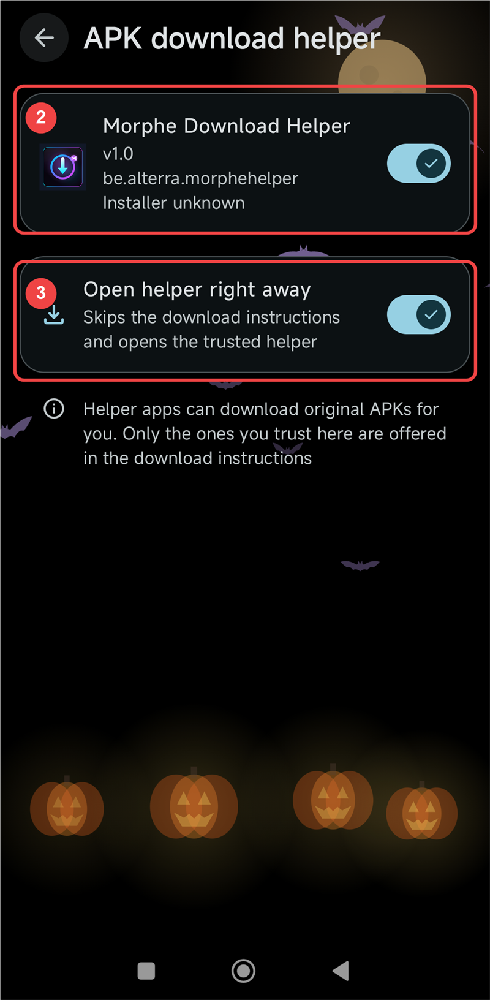

# Setup Guide

This guide shows how to enable **Morphe Download Helper** inside Morphe and, optionally, make
Morphe open the helper automatically when it needs an APK.

> **Unofficial:** this helper is not affiliated with or endorsed by the Morphe project.

## Before you start

1. Install the latest APK from the [Releases page](https://github.com/GeneralZyonix/morphe-download-helper/releases).
2. Open the helper once so Android registers it.
3. Use Morphe **2.3.0 or newer**, which includes the APK download helper integration.

## Step 1: Open Morphe's helper settings

Open Morphe, tap **Settings** in the bottom bar, scroll down to the **Files** section, and tap
**APK download helper**.

## Step 2: Trust the helper

On the **APK download helper** screen, find **Morphe Download Helper** and turn on its toggle.
Morphe will ask you to confirm with **Trust**. When it is enabled, the subtitle should show
something like **Trusted: 1 of 1**.

## Optional step 3: Open the helper automatically

Turn on **Open helper right away** if you want Morphe to skip the download instructions and
launch the helper directly when you choose **Help me find an APK**.

If this option is off, Morphe still works normally: it shows the download instructions and a
**Use a helper app** button, which opens the helper when you tap it.

## Visual guide

The red numbers match the steps above. Tap an image to open it larger.

| 1 — Open the settings row | 2 & 3 — Trust and auto-open |
| --- | --- |
|  |  |

## Step 4: Use it while patching

1. Pick an app in Morphe.
2. Choose **Help me find an APK** (or **Use a helper app**).
3. The helper opens with the requested package and version.
4. Wait for the download to finish. The helper returns the file to Morphe automatically.
5. Morphe validates the package, version, and signature, then continues patching.

If the helper cannot find a downloadable APK, it offers **Open download page**. Morphe will
also show its own default download button so you can continue manually.

## Troubleshooting

| Problem | What to do |
| --- | --- |
| The **APK download helper** row is missing | Install/update the helper, then fully close and reopen Morphe. |
| The helper toggle will not stay on | Confirm the **Trust** prompt. Make sure the latest version is installed. |
| The helper opens but fails to download | Open the helper and tap **Share log** for details. Uptodown opens a verification page; APKMirror/APKPure may block automated requests. |
| Morphe says the helper did not return an APK | Use **Open download page** or Morphe's default download button. |
| **Installer unknown** is shown | Normal for an APK sideloaded outside the Play Store. |

## Notes

- The helper only downloads original APKs. It never installs or patches anything itself.
- Only download apps you are allowed to access, and respect the APK sources' terms of service.
- One universal APK supports Android 6.0+ on arm64-v8a, armeabi-v7a, x86, and x86_64.

Still stuck? [Open a bug report](https://github.com/GeneralZyonix/morphe-download-helper/issues/new?template=bug_report.yml)
and include the helper log if possible.
