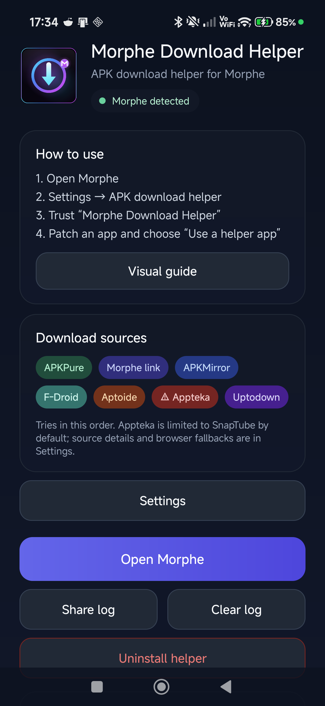
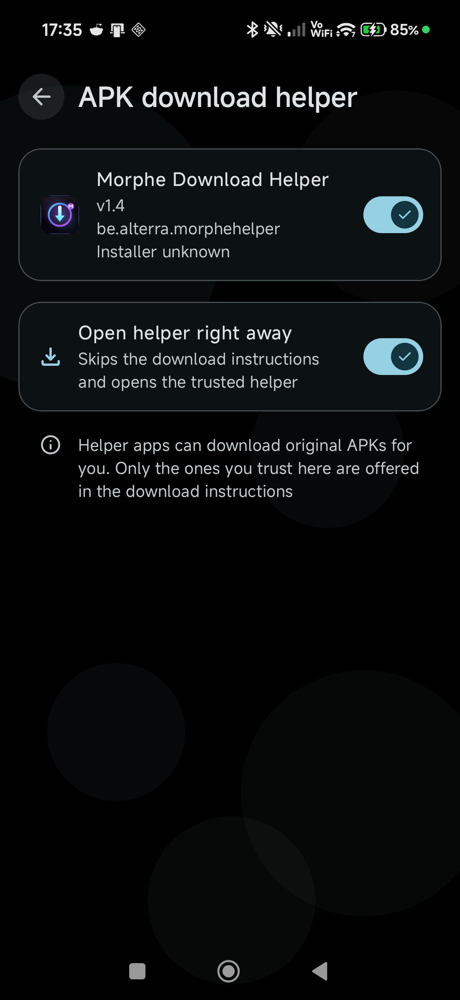
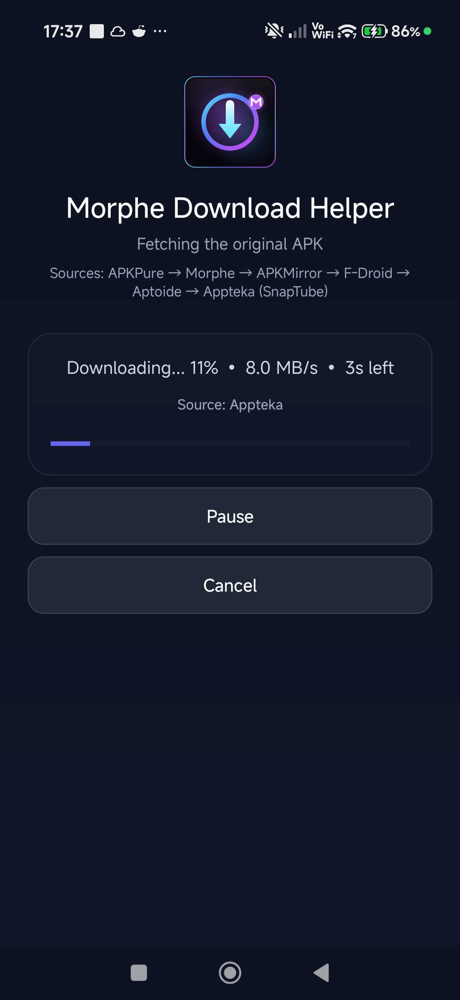

# Morphe Download Helper

<p align="center">
  
</p>

An unofficial Android helper app that downloads the original APK requested by
[Morphe Manager](https://github.com/MorpheApp/morphe-manager) and hands it back through
Morphe's open `DOWNLOAD_ORIGINAL_APK` intent contract.

> **Unofficial:** this project is not affiliated with, endorsed by, or maintained by the
> Morphe project. Morphe ships no helper of its own and does not endorse any helper.

## Choose your build

Android 10+ does not allow one package to show a launcher icon immediately after
installation **and** hide it cleanly later. From 2.3.3 the helper ships as two
builds of the same app, so you can choose the behavior you want:

| Build | Launcher icon | Best for |
| --- | --- | --- |
| **Icon** — `MorpheDownloadHelper-v2.3.5-universal.apk` | Always shown | Normal use. The icon appears immediately after installation. There is no hide toggle. |
| **No-icon** — `MorpheDownloadHelper-v2.3.5-universal-noicon.apk` | Never shown | A clean app drawer. Open the helper from Morphe or Android Settings → Apps → Morphe Download Helper → Open. |

Both builds have the same package name, version, signing key, and features.
Install one or the other, not both. The in-app updater stays on the build you
installed. When switching from the icon build to the no-icon build, do a fresh
install or remove the old home-screen shortcut if your launcher keeps it.

## Recent highlights

- **2.3.5:** fast source checks, multi-connection downloads on by default, parallel
  GitHub searches, and an optional `helper-settings.txt` that is no longer created
  automatically.
- **2.3.4:** the helper chip names the installed build, skipped sources explain
  why they were skipped, APKCube “app not found” pages are detected even when
  the message appears briefly before a reload, and the French translation is
  complete again.
- **2.3.3:** two launcher builds (icon and no-icon), GitHub-only apps found by
  package name in READMEs, correct ARMv8/ARMv7 GitHub asset selection, and
  immediate APKCube “no match” continuation.
- **2.3.2:** **Report on GitHub** with short/full log options and log redaction,
  Morphe/helper version pills, the log card above About, and automatic
  continuation after a failed verification WebView.
- **2.3.1:** full APKPure XAPK downloads for split requests and a clean restart
  when a resumed download stalls.
- **2.3.0:** Uptodown became a first-class API source with SHA-256 verification.

## Setup Guide

New to the helper? Follow the **[illustrated setup guide](GUIDE.md)** to enable it in Morphe,
trust it, and optionally make Morphe open it automatically.

## Report an issue

Found a bug or want a feature? Use the issue forms:

- [Report a bug](https://github.com/GeneralZyonix/morphe-download-helper/issues/new?template=bug_report.yml)
- [Request a feature](https://github.com/GeneralZyonix/morphe-download-helper/issues/new?template=feature_request.yml)

Please include:

- Helper version
- Android version and device
- Morphe version
- The app and version being patched
- The helper log if possible — open the helper and use **Report on GitHub** in the
  Helper log section, or tap **Share log** and attach `helper.log` to the issue

## Features

- Receives the package, version, version codes, file type, ABIs, and fallback URL from Morphe.
- Follows the same resolver link Morphe's own download dialog uses.
- Falls back to APKMirror, APKPure, APKCube, Uptodown, F-Droid, Aptoide, and Appteka for SnapTube.
- Uses APKPure's numeric `versionCode` endpoint, so the exact requested build is downloaded
  instead of the latest version.
- Supports APK, APKM, APKS, and XAPK when Morphe allows split archives.
- Uses Uptodown's mobile API for exact versions and SHA-256, with the in-app verification page as a fallback.
- Two builds: **icon** (launcher entry always visible) and **no-icon**
  (launcher entry always hidden; opened from Morphe or Android Settings).
- Opens APKPure, APKCube, or Uptodown in an inline WebView when a site needs a browser check.
- If a verification WebView times out, errors, or cannot capture a download, marks that
  source as failed and continues with the next enabled source.
- Detects APKCube “no match / package isn’t in the catalog” pages immediately, even when
  the message appears briefly before a reload, instead of waiting for the WebView timeout.
- Returns a `content://` URI with read permission so Morphe can validate and use the file.
- Rejects downloaded APKs whose package or version does not match the request.
- Shows a dark, modern UI with a **Sources** shortcut that opens source settings.
- Shows per-source failure details and offers **Retry all sources**, **Retry failed sources**, and **Copy details**.
- Settings shows source type badges and a per-source **Test** action, plus **Copy log**, **Save log**, and **Help**.
- The main screen shows Morphe's detected version and the helper version in theme-aware pills; the helper chip also names the installed build (`Icon` or `No icon`). It puts the log actions above About and offers a **Report on GitHub** flow with short and full-log options.
- Download progress screen with the target app icon, version/format/ABI chips, Source/Size/Connections metrics, active source logo beside the Source value, package pill, verification warning card, speed/ETA pill, and distinct Pause/Switch/Cancel actions. The source card collapses to a compact summary during the download, expands automatically on a failure, a fallback note, or **Switch source**, and its rows can be tapped to switch sources.
- Single-stream downloads retry a dropped connection and resume from the `.part` offset with `Range`/`If-Range`; multi-connection segments resume from their written offset.
- Multi-connection downloads are on by default for files of 5 MB and larger when the server supports HTTP Range. APKMirror uses the single-stream path; servers without range support fall back automatically.
- WebView flows log state transitions and fail fast on main-frame load errors, renderer crashes, and permanent HTTP errors. A failed WebView no longer ends the whole resolution; the next enabled source is tried.
- Uses GitHub automatically: immediately when Morphe's resolver points to a release, or as
  the final fallback when normal APK sources fail. Automatic search needs a version; when
  Morphe supplies none, the GitHub row and report explain that it was skipped. Remembered
  and pinned repositories are still tried. There is no separate GitHub button.
- GitHub search looks for the package name in READMEs as well as the app name, so renamed
  repositories (for example Myspoti → Orpheon) are still found.
- GitHub asset selection understands `ARMv8`, `ARMv7`, `ARM64`, `AArch64`, `x86_64`, and
  `universal` naming.
- Remembers successful GitHub repositories, and lets you pin a repository to a
  package with an optional asset filter and **Try this repo first**.
- Keeps a structured, human-readable diagnostic log that can be shared from the app.
- Built-in update checker with a changelog screen: notify me, or install silently through
  Shizuku. Forks that use a different package name are supported with a configurable
  manager package, with an optional battery-optimization exemption.
- Optional **VirusTotal hash check** before handing an APK to Morphe. Hash lookup is the
  default; uploading unknown files, always uploading, or falling back to upload when the
  lookup quota is exceeded are separate opt-in settings.
- Settings for the download folder, retention, source order, and individual sources.
- **Fast source checks** (default on) probe APKPure's API and direct endpoints together,
  check APKCube's no-match page in the background, and reject unrelated APKMirror search
  results before opening their page.
- Saves downloaded APKs to `Downloads/Morphe Helper` by default on Android 10+, with
  internal, external, and custom-folder options.
- `helper-settings.txt` is optional. It is created only from **Settings → Backup → Create
  settings file**; existing files are kept in sync, and deleting the file stops syncing
  without recreating it.
- Appteka is limited to SnapTube by default and carries a hazard warning. It is not
  recommended for other apps because Appteka hosts modded APKs.

## Screenshots

| Launcher | Setup | Download |
| --- | --- | --- |
|  |  |  |

## Download

Grab one of the two current APKs from the
[Releases page](https://github.com/GeneralZyonix/morphe-download-helper/releases):

- `MorpheDownloadHelper-v2.3.5-universal.apk` — **icon build**
- `MorpheDownloadHelper-v2.3.5-universal-noicon.apk` — **no-icon build**

Both are written in Java, contain no native libraries, and work on all CPU
architectures (arm64-v8a, armeabi-v7a, x86, x86_64) and on **Android 6.0+**
(minSdk 23). Install one; they share the same package and cannot coexist.

> Release APKs are signed with the Android debug key so they can be sideloaded,
> and the release build is non-debuggable. A proper release keystore can be
> added later for Play Store-style signing continuity.

## How it works

Morphe sends an intent with the action
`app.morphe.manager.action.DOWNLOAD_ORIGINAL_APK`. The helper:

1. Reads the request extras, including the package, version, numeric version codes, ABIs,
   file type, and fallback URL.
2. If a numeric `versionCode` is available, tries APKPure's direct endpoint first, then its API.
3. If APKPure does not have the build, asks Morphe's resolver API for the page Morphe would show.
4. Tries the patch bundle's fallback URL, then APKMirror by package and version
   (using its WordPress `?s=` search and an app-page cache).
5. Falls back to APKPure, F-Droid, Aptoide, and Appteka (SnapTube only by default).
6. If a source needs a browser check, opens it in an inline WebView and captures the final
   download link. APKPure's WebView is the last resort.
7. Returns `RESULT_OK`, a `content://` URI, and `FLAG_GRANT_READ_URI_PERMISSION`.

Morphe then re-checks the package name, version, and signature before using the file.
The helper never installs anything.

## Download sources

| Order | Source | Processing |
| --- | --- | --- |
| 0 | APKPure fast path | When Morphe sends a numeric versionCode, request `d.apkpure.com/b/{APK or XAPK}/{package}?versionCode=...` immediately, then use the APKPure API if needed. Split requests (`xapk`/`apkm`/`apks`) always use the XAPK endpoint and never the standalone APK, which is only `base.apk` for split apps. |
| 1 | Morphe resolver | Calls `api.morphe.software/v2/web-search`; Morphe redirects to the direct store page (for example APKMirror/Uptodown). Cached for 3 hours. |
| 2 | Patch-bundle fallback URL | The `FALLBACK_WEB_URL` extra from the patch bundle; usually a Google search URL, which is skipped, but may be a direct file/store page. |
| 3 | APKMirror | Searches with the WordPress `?s=` endpoint, scores the results by app slug/name/package, verifies the app page against its Play Store package, then resolves the variant and download key. The app page is cached per package for repeat downloads. |
| 4 | APKPure fallback | Used when there is no versionCode, or the fast path did not find the build. Only split assets are accepted for split requests. |
| 5 | APKCube | Opens the exact build/ABI page in an in-app WebView; the user completes APKCube's verification. A “no match” page is detected immediately and the next source is tried. |
| 6 | Uptodown | Authenticates to Uptodown's mobile eAPI, resolves the exact version/file ID from the public versions JSON, downloads the direct CDN URL, and verifies SHA-256. Falls back to the in-app verification page if the API changes. |
| 7 | F-Droid | Queries the F-Droid package API and downloads the matching version code. |
| 8 | Aptoide | Queries the Aptoide API; only uploads marked `TRUSTED` are accepted. |
| 9 | Appteka | Resolves the exact version by package and version code. SnapTube only by default; the source is marked as hazardous because it hosts modded APKs. |
| 10 | GitHub releases | Uses the release immediately when Morphe's resolver points to GitHub. Otherwise it is the automatic last resort: tries a remembered repository or searches by package name in READMEs and by app name, handles renamed repositories, checks the requested version, prefers ARMv8/ARMv7/ARM64 assets, and remembers the repository. A user-added per-app mapping can run before the Morphe link instead. |
| WebView fallback | APKPure / APKCube / Uptodown | APKPure's page is the last resort. APKCube and Uptodown open an in-app verification page when their direct/API path cannot be used. If a verification page fails or times out, the helper marks that source as failed and continues with the next enabled source. |

The patch bundle's Google search fallback is not scraped; the helper skips it and uses the
sources above. GitHub is automatic: there is no **Search GitHub releases** button anymore.
When Morphe's resolver points to a GitHub release, the helper uses that release immediately
for the patch source. Otherwise GitHub is the final fallback. It stores the repository name
(`owner/repo`), not a fixed APK, and selects the matching release version each time.

**Settings → GitHub apps** accepts user-added per-package mappings:

- **Try this repo first** (default on) inserts the mapping before the Morphe link.
- With it off, the mapping is fallback-only and appears in **Switch source** plus a note on
  the download screen.
- The optional asset-name filter is a case-insensitive `contains` match, for example
  `universal`, `foss`, or `arm64`.
- User-added entries are marked **USER**; auto-remembered entries are marked **AUTO**. You
  are responsible for repositories you add. Configuration export/import includes user-added
  mappings and imports them as user-added.

If no downloadable APK is found, the helper returns `RESULT_CANCELED` and Morphe shows its
own default download button.

## Limitations

- Only apps with an available APK on the supported sources can be resolved automatically.
- APKPure's direct endpoint needs Morphe's numeric `versionCode`; without it the helper
  opens the APKPure page in a WebView.
- Uptodown and APKPure WebView pages may show ads or a verification challenge; the page can
  be refreshed, and the user may need to tap the direct download button.
- APKMirror/APKPure/Aptoide can change their HTML or block automated requests at any time.
- Appteka is limited to SnapTube by default. It hosts modded APKs, so enabling it for other
  apps is not recommended and may return altered or unstable builds.
- The helper does not bypass paid apps, license checks, account restrictions, or DRM.
- Automatic downloads may be restricted by the APK sites' terms of service. Use the helper
  responsibly and only download apps you are allowed to access.

## Build

Requirements:

- JDK 21
- Android SDK Platform 35
- Gradle 8.9 (the included wrapper handles this)

Set `sdk.dir` in `local.properties` (or set `ANDROID_HOME`), then run:

```bash
./gradlew :app:assembleIconDebug :app:assembleNoiconDebug
```

On Windows:

```powershell
.\gradlew.bat :app:assembleIconDebug :app:assembleNoiconDebug
```

The two build flavors differ only in the launcher alias default. Release
builds use `:app:assembleIconRelease` and `:app:assembleNoiconRelease`.

The debug APKs are written to:

```text
app/build/outputs/apk/icon/debug/app-icon-debug.apk
app/build/outputs/apk/noicon/debug/app-noicon-debug.apk
```

## Install

```bash
# icon build
adb install -r app/build/outputs/apk/icon/debug/app-icon-debug.apk
# no-icon build
adb install -r app/build/outputs/apk/noicon/debug/app-noicon-debug.apk
```

Then open Morphe → Settings → APK download helper, trust **Morphe Download Helper**, and
use **Use a helper app** during patching. The no-icon build has no launcher entry; open it
from Morphe or Android Settings → Apps → Morphe Download Helper → Open.

## Privacy

- No analytics, telemetry, or accounts.
- Downloads go directly from the APK source to the device.
- The diagnostic log stays in the app-specific storage:
  `Android/data/be.alterra.morphehelper/files/logs/helper.log`
- Logs are only shared when the user taps **Share log** or **Report on GitHub**.
  GitHub reports redact query tokens and signed URL fragments before opening the
  form.

## Project layout

```text
app/src/main/java/be/alterra/morphehelper/
  MainActivity.java      Launcher screen, log and source shortcuts
  DownloadActivity.java  Morphe intent contract, resolver, source parsers, WebView fallback
  SettingsActivity.java  Download source toggles
  SourceSettings.java    Persisted source preferences
  HelperLog.java         Local append-only diagnostic log
  GitHubReport.java      GitHub issue URL and log redaction helper
app/src/main/res/
  drawable/              Logo and warning icon
  values/                Strings and dark theme
  xml/file_paths.xml     FileProvider paths
docs/guide/              Setup guide screenshots
GUIDE.md                 Step-by-step Morphe setup guide
```

## Contributing

Issues and pull requests are welcome. Please keep source parsers small and well commented,
and test changes against a real Morphe request before opening a PR.

## Translations

Currently supported languages:

| Language | Code | Strings |
| --- | --- | --- |
| English | `en` | [values/strings.xml](app/src/main/res/values/strings.xml) |
| French | `fr` | [values-fr/strings.xml](app/src/main/res/values-fr/strings.xml) |

Want to add a language? See [TRANSLATING.md](TRANSLATING.md) for the English strings,
placeholder rules, and import instructions. New languages appear automatically in
**Settings → App language** after their locale is added to
[locales_config.xml](app/src/main/res/xml/locales_config.xml).

## Changelog

See [CHANGELOG.md](CHANGELOG.md) for release notes.

## License

MIT — see [LICENSE](LICENSE).

## Disclaimer

This project is provided as-is. The authors are not responsible for how it is used. Only
download applications you are legally allowed to access, and respect the terms of service
of the APK sources listed above.


