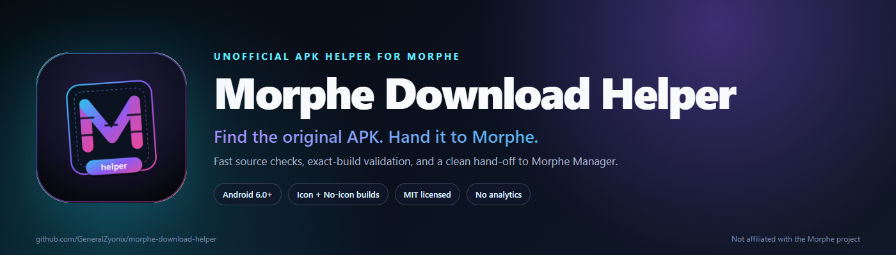
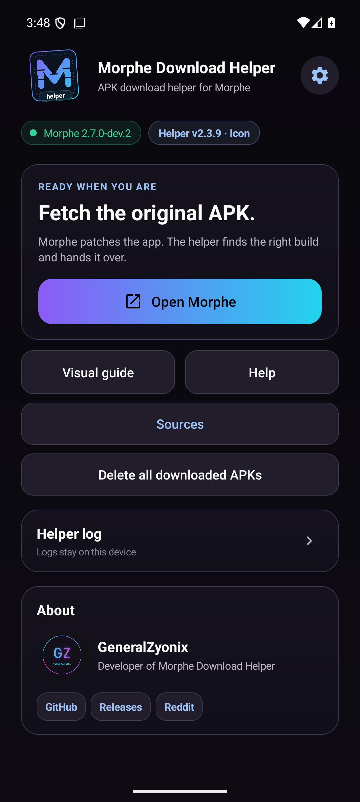
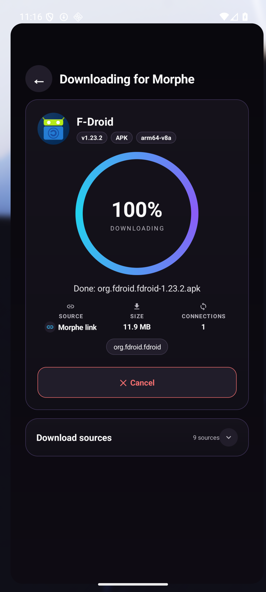
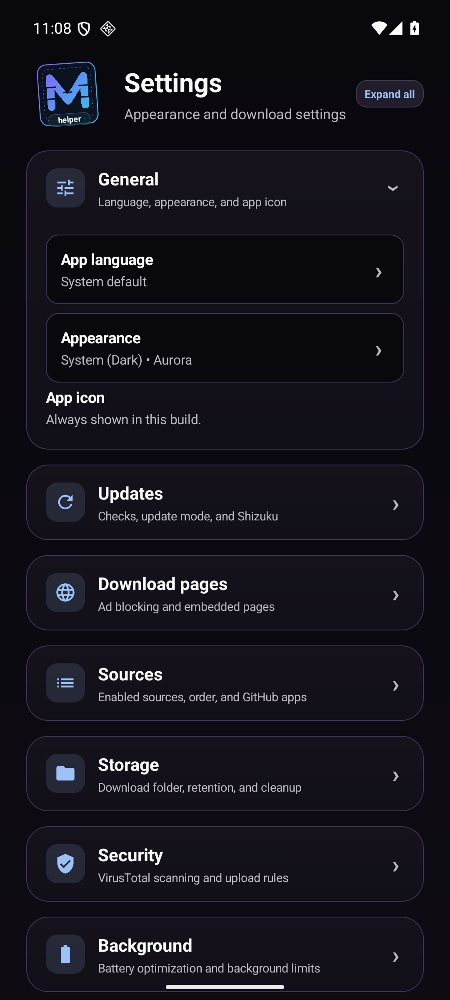

<p align="center">
  <a href="https://github.com/GeneralZyonix/morphe-download-helper/releases">
    
  </a>
</p>

<p align="center">
  <a href="https://github.com/GeneralZyonix/morphe-download-helper/releases"></a>
  <a href="https://github.com/GeneralZyonix/morphe-download-helper/blob/main/LICENSE"></a>
  
  
</p>

**Morphe Download Helper** is an unofficial Android helper that finds the original APK
[Morphe Manager](https://github.com/MorpheApp/morphe-manager) needs, verifies that it matches
the requested package/version/build, and hands it back through Morphe's open
`DOWNLOAD_ORIGINAL_APK` intent contract.

It is a downloader, not a patcher. It never installs, modifies, or uploads an app on its own.

> **Unofficial:** this project is not affiliated with, endorsed by, or maintained by the
> Morphe project. Morphe ships no helper of its own and does not endorse any helper.

## Why use it?

- **Exact-build matching.** The helper validates package name, version name, version code,
  ABI, and archive type before handing a file to Morphe.
- **Many sources, one flow.** Morphe's resolver link, APKMirror, APKPure, APKCube,
  Uptodown, F-Droid, Aptoide, Appteka, and GitHub releases are tried in your chosen order.
- **Fast source resolution.** Parallel metadata checks, APKCube no-match preflight,
  APKPure endpoint racing, and a short-lived not-found cache cut the usual waiting.
- **Repeat requests are instant.** An exact repeat request is served from the helper's
  validated local cache after rechecking package/version/build.
- **Fast large downloads.** Multi-connection downloading is on by default for compatible
  servers and files of 5 MB or more.
- **Transparent failures.** Every source shows a status, a reason, and how long it took.
- **Private by default.** No analytics, no accounts, and logs stay on your device.

## Download

Grab one of the two current builds from the
[Releases page](https://github.com/GeneralZyonix/morphe-download-helper/releases):

| Build | Launcher icon | Best for |
| --- | --- | --- |
| **Icon** — `MorpheDownloadHelper-v2.3.9-universal.apk` | Always shown | Normal use. The icon appears immediately after installation. There is no hide toggle. |
| **No-icon** — `MorpheDownloadHelper-v2.3.9-universal-noicon.apk` | Never shown | A clean app drawer. Open the helper from Morphe or Android Settings → Apps → Morphe Download Helper → Open. |

Both builds have the same package name, version, signing key, and features. Install one or
the other, not both. The in-app updater stays on the build you installed. When switching
from the icon build to the no-icon build, do a fresh install or remove the old home-screen
shortcut if your launcher keeps it.

> Release APKs are signed with the Android debug key so they can be sideloaded, and the
> release build is non-debuggable. A proper release keystore can be added later for
> Play Store-style signing continuity.

## Screenshots

| Main screen | Download complete | Settings |
| --- | --- | --- |
|  |  |  |

See the **[settings guide with screenshots](docs/SETTINGS.md)** for every section and what
each option does.

## Setup

New to the helper? Follow the **[illustrated setup guide](GUIDE.md)**. In short:

1. Install the icon or no-icon APK.
2. Open Morphe → **Settings** → **Files** → **APK download helper**.
3. Turn on **Morphe Download Helper** and confirm **Trust**.
4. Optionally enable **Open helper right away**.
5. Pick an app in Morphe and choose **Help me find an APK** or **Use a helper app**.

The in-app **Visual guide** and **Help** buttons repeat these steps with screenshots.

## How it works

1. Morphe sends the package, version, version codes, file type, ABIs, and fallback link to
   the helper.
2. The helper checks its validated local cache for an exact repeat request.
3. Otherwise it follows the enabled sources in your order. With **Fast source checks** on,
   HTTP/API metadata is prefetched and the APKPure/Uptodown/APKCube paths are prepared in
   parallel.
4. The first source that produces a valid file wins. Split requests use `.xapk`, `.apks`,
   or `.apkm` bundles and are never replaced with a standalone `base.apk`.
5. The downloaded file is checked against the request. GitHub releases additionally get a
   signature check when the app is installed.
6. The helper returns a `content://` URI to Morphe and optionally saves a copy in
   `Downloads/Morphe Helper`.

## Sources

The order is configurable in **Settings → Sources**. The default is:

| # | Source | What it does |
| --- | --- | --- |
| 1 | Morphe link | Follows the exact resolver/fallback link supplied by Morphe. |
| 2 | APKMirror | Searches by package, verifies the Play package, and selects the requested version/ABI. |
| 3 | APKPure | Uses the exact `versionCode` API and direct endpoints; supports APK/XAPK/APKS/APKM. |
| 4 | APKCube | Catalogue search with a background no-match preflight and an in-app verification fallback. |
| 5 | Uptodown | Mobile API with exact versions and SHA-256; falls back to the in-app verification page. |
| 6 | F-Droid | Package API; only apps hosted by F-Droid. |
| 7 | Aptoide | API search; only uploads marked **TRUSTED**. |
| 8 | Appteka | Exact version/code; **SnapTube only by default** and marked hazardous. |
| 9 | GitHub releases | Resolver links and remembered/pinned repositories first; automatic search is the final fallback. |

WebView verification is used only when a site requires a browser check. If a page fails or
times out, the helper marks that source failed and continues with the next one.

### GitHub behavior

- A resolver-supplied GitHub release is used immediately.
- Remembered and pinned repositories are tried even when Morphe supplies no version.
- Automatic GitHub search needs a version. Without one, the GitHub row/report shows
  **SKIPPED — No version supplied for automatic search** instead of looking untried.
- GitHub search looks for the package name in READMEs and the app name in repository names,
  so renamed repositories are still found. Release assets named `ARMv8`/`ARMv7`/`ARM64`/
  `x86_64`/`universal` are scored for the device ABI.

## Features

- Exact-build APK validation before hand-off.
- APK, APKM, APKS, and XAPK support when Morphe allows split archives.
- Fast source checks (on by default): APKPure/Uptodown/APKMirror/F-Droid/Aptoide metadata
  prefetch, APKCube no-match preflight, APKPure API/direct race, and APKMirror early
  rejection.
- Short-lived negative cache for definitive “not found” results; transient network errors
  are never cached, and retry actions bypass it.
- Validated local-cache fast path for exact repeat requests.
- Multi-connection downloads for large files on servers that support HTTP Range;
  APKMirror stays single-stream.
- Per-source status, reason, and timing in the final report.
- Two launcher builds: icon and no-icon.
- Optional `helper-settings.txt`, created and deleted only from **Settings → Backup**.
- Optional **VirusTotal** hash check before hand-off; uploads are separate opt-ins.
- Theme options: Dark, AMOLED, Light, System, 11 color accents, a custom color scheme,
  and Material You accent on Android 12+.
- French translation included; the app language can follow the system or be set in Settings.
- Built-in update checker with a changelog screen and optional Shizuku silent install.
- **Report on GitHub** with short/full log options and automatic redaction of signed URLs
  and tokens.

## Settings

The full illustrated reference is in **[docs/SETTINGS.md](docs/SETTINGS.md)**. Quick map:

- **General** — app language, appearance, and the installed launcher variant.
- **Updates** — automatic checks, update mode, in-app popup, and a manual check.
- **Download pages** — ad/tracker blocking and optional live AdGuard host checks.
- **Sources** — enable/disable, reorder, test sources, Fast source checks, and GitHub apps.
- **Storage** — download folder, retention, multi-connection downloads, maximum connections,
  and deleting all downloaded APKs.
- **Security** — optional VirusTotal API key, detection action, upload rules, and quota
  behavior.
- **Background** — battery-optimization exemption for reliable background checks.
- **Backup** — export/import configuration, plus optional creation or deletion of
  `helper-settings.txt`.
- **Appearance** — theme mode, accent, custom scheme, surface tinting, and reset.

## Privacy and security

- No analytics, telemetry, accounts, or automatic uploads.
- The diagnostic log stays in app-specific storage and is only shared when you tap
  **Share log**, **Save log**, **Copy log**, or **Report on GitHub**.
- Signed download URLs and tokens are redacted from GitHub reports.
- Downloads go directly from the APK source to the device.
- The optional VirusTotal check only runs after you enable it and add an API key. Uploads
  are separately opt-in and share the APK with VirusTotal.
- The helper never installs an APK and never patches an app. Morphe performs the final
  package/version/signature checks and patching.

## Limitations

- APKMirror, APKPure, APKCube, and Uptodown can require Cloudflare/Turnstile verification.
  The helper shows the page when needed; a changed site layout can still break a source.
- Automatic GitHub search requires a version. Without one, remembered/pinned repos are
  still tried but a broad automatic search is skipped.
- Custom icon-pack artwork for uninstalled apps is a One UI/Android limitation. The helper
  uses the source page icon or the APK's own icon instead.
- Android 10+ cannot show a launcher icon immediately after install and hide it cleanly
  later in the same package. Use the icon or no-icon build.
- APK site terms of service still apply. Only download apps you are allowed to access.
- Paid apps cannot be fetched unless the source publicly provides the file.

## Build

Requirements:

- JDK 21
- Android SDK Platform 35
- Gradle 8.9 (the included wrapper handles this)

Set `sdk.dir` in `local.properties` (or `ANDROID_HOME`), then:

```bash
./gradlew :app:assembleIconDebug :app:assembleNoiconDebug
```

On Windows:

```powershell
.\gradlew.bat :app:assembleIconDebug :app:assembleNoiconDebug
```

Release builds:

```bash
./gradlew :app:assembleIconRelease :app:assembleNoiconRelease
```

Debug APKs:

```text
app/build/outputs/apk/icon/debug/app-icon-debug.apk
app/build/outputs/apk/noicon/debug/app-noicon-debug.apk
```

## Install

```bash
# icon build
adb install -r app/build/outputs/apk/icon/debug/app-icon-debug.apk

# no-icon build
adb install -r app/build/outputs/apk/noicon/debug/app-noicon-debug.apk
```

Then open Morphe → **Settings** → **Files** → **APK download helper**, trust the helper, and
optionally enable **Open helper right away**.

## Project layout

```text
app/src/main/java/be/alterra/morphehelper/
  DownloadActivity.java       request flow, sources, WebView fallbacks, downloads
  MainActivity.java           main screen and log actions
  SettingsActivity.java       settings, sources, backup, and permissions
  AppearanceActivity.java     theme and accent controls
  GitHubReleaseResolver.java  GitHub search and asset selection
  DownloadCache.java          validated repeat-request cache
  SourceNegativeCache.java    short-lived definite not-found cache
  PublicSettings.java         optional helper-settings.txt
  DownloadedFileValidator.java package/version/ABI validation
docs/
  SETTINGS.md                 illustrated settings reference
  screenshots/                current screenshots
  guide/                      Morphe setup screenshots
  branding/                   README banner and source assets
GUIDE.md                      illustrated Morphe setup guide
```

## Contributing

Issues and pull requests are welcome. Please keep source parsers small and well commented,
and test changes against a real Morphe request before opening a PR.

- [Report a bug](https://github.com/GeneralZyonix/morphe-download-helper/issues/new?template=bug_report.yml)
- [Request a feature](https://github.com/GeneralZyonix/morphe-download-helper/issues/new?template=feature_request.yml)

Please include the helper version, Android version/device, Morphe version, the app/version
being patched, and the helper log when possible. Open the helper and use **Report on GitHub**
or **Share log**.

### Tests

```bash
./gradlew :app:testIconDebugUnitTest :app:testNoiconDebugUnitTest
./gradlew :app:connectedIconDebugAndroidTest :app:connectedNoiconDebugAndroidTest
```

## Translations

| Language | Code | Strings |
| --- | --- | --- |
| English | `en` | [values/strings.xml](app/src/main/res/values/strings.xml) |
| French | `fr` | [values-fr/strings.xml](app/src/main/res/values-fr/strings.xml) |

Want to add a language? See [TRANSLATING.md](TRANSLATING.md). New languages appear
automatically in **Settings → App language** after their locale is added to
[locales_config.xml](app/src/main/res/xml/locales_config.xml).

## Changelog

See [CHANGELOG.md](CHANGELOG.md) for release notes.

## License

MIT — see [LICENSE](LICENSE).

## Disclaimer

Morphe Download Helper is an independent community project. It is not affiliated with,
endorsed by, or maintained by the Morphe project or any APK site. Use it responsibly and
only download apps you are allowed to access.
