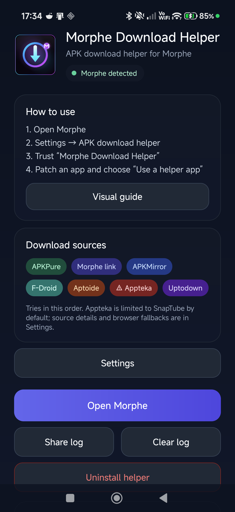
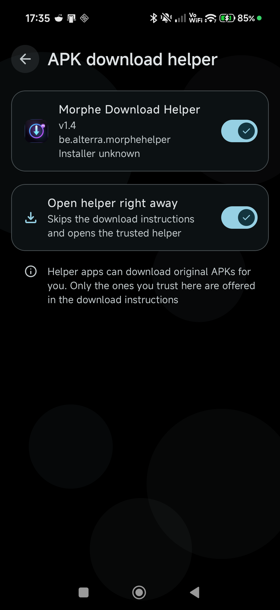
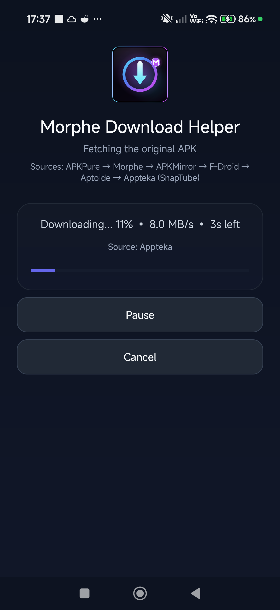

# Morphe Download Helper

<p align="center">
  
</p>

An unofficial Android helper app that downloads the original APK requested by
[Morphe Manager](https://github.com/MorpheApp/morphe-manager) and hands it back through
Morphe's open `DOWNLOAD_ORIGINAL_APK` intent contract.

> **Unofficial:** this project is not affiliated with, endorsed by, or maintained by the
> Morphe project. Morphe ships no helper of its own and does not endorse any helper.

## Setup Guide

New to the helper? Follow the **[illustrated setup guide](GUIDE.md)** to enable it in Morphe,
trust it, and optionally make Morphe open it automatically.

## Report an issue

Found a bug or want a feature? Use the issue forms:

- [Report a bug](https://github.com/GeneralZyonix/morphe-download-helper/issues/new?template=bug_report.yml)
- [Request a feature](https://github.com/GeneralZyonix/morphe-download-helper/issues/new?template=feature_request.yml)

Please include:

- Helper version
- Android version and device
- Morphe version
- The app and version being patched
- The helper log if possible — open the helper and tap **Share log**, then attach
  `helper.log` to the issue

## Features

- Receives the package, version, version codes, file type, ABIs, and fallback URL from Morphe.
- Follows the same resolver link Morphe's own download dialog uses.
- Falls back to APKMirror, APKPure, F-Droid, Aptoide, and Appteka for SnapTube.
- Uses APKPure's numeric `versionCode` endpoint, so the exact requested build is downloaded
  instead of the latest version.
- Supports APK, APKM, APKS, and XAPK when Morphe allows split archives.
- Opens Uptodown or APKPure in an inline WebView when a site needs a browser check.
- Returns a `content://` URI with read permission so Morphe can validate and use the file.
- Shows a dark, modern UI with a source list and clear limitations.
- Keeps a local diagnostic log that can be shared from the app.
- Settings for the download folder, retention, source order, and individual sources.
- Appteka is limited to SnapTube by default and carries a hazard warning. It is not
  recommended for other apps because Appteka hosts modded APKs.

## Screenshots

| Launcher | Setup | Download |
| --- | --- | --- |
|  |  |  |

## Download

Grab the latest universal APK from the
[Releases page](https://github.com/GeneralZyonix/morphe-download-helper/releases).

The app is written in Java and contains no native libraries, so **one universal APK works on
all CPU architectures** (arm64-v8a, armeabi-v7a, x86, x86_64) and on **Android 6.0+**
(minSdk 23). Separate per-ABI APKs are not needed.

> Release APKs are currently signed with the Android debug key so they can be sideloaded.
> A proper release keystore can be added later for Play Store-style signing continuity.

## How it works

Morphe sends an intent with the action
`app.morphe.manager.action.DOWNLOAD_ORIGINAL_APK`. The helper:

1. Reads the request extras, including the package, version, numeric version codes, ABIs,
   file type, and fallback URL.
2. If a numeric `versionCode` is available, tries APKPure's direct endpoint first, then its API.
3. If APKPure does not have the build, asks Morphe's resolver API for the page Morphe would show.
4. Tries the patch bundle's fallback URL, then APKMirror by package and version.
5. Falls back to APKPure, F-Droid, Aptoide, and Appteka (SnapTube only by default).
6. If a source needs a browser check, opens it in an inline WebView and captures the final
   download link. APKPure's WebView is the last resort.
7. Returns `RESULT_OK`, a `content://` URI, and `FLAG_GRANT_READ_URI_PERMISSION`.

Morphe then re-checks the package name, version, and signature before using the file.
The helper never installs anything.

## Download sources

| Order | Source | Processing |
| --- | --- | --- |
| 0 | APKPure fast path | When Morphe sends a numeric versionCode, request `d.apkpure.com/b/{APK or XAPK}/{package}?versionCode=...` immediately, then use the APKPure API if needed. |
| 1 | Morphe resolver | Calls `api.morphe.software/v2/web-search`; Morphe redirects to the direct store page (for example APKMirror/Uptodown). Cached for 3 hours. |
| 2 | Patch-bundle fallback URL | The `FALLBACK_WEB_URL` extra from the patch bundle; usually a Google search URL, which is skipped, but may be a direct file/store page. |
| 3 | APKMirror | Searches by package name, matches the requested version, then resolves the variant and download key. |
| 4 | APKPure fallback | Used when there is no versionCode, or the fast path did not find the build. |
| 5 | F-Droid | Queries the F-Droid package API and downloads the matching version code. |
| 6 | Aptoide | Queries the Aptoide API; only uploads marked `TRUSTED` are accepted. |
| 7 | Appteka | Resolves the exact version by package and version code. SnapTube only by default; the source is marked as hazardous because it hosts modded APKs. |
| WebView | Uptodown / APKPure | Uptodown opens from the resolver. APKPure’s page is the last resort so it cannot block the other sources. |

The patch bundle's Google search fallback is not scraped; the helper skips it and uses the
sources above. Manage sources, order, and storage in the app under **Settings**. If no
downloadable APK is found, the helper returns `RESULT_CANCELED` and Morphe shows its own
default download button.

## Limitations

- Only apps with an available APK on the supported sources can be resolved automatically.
- APKPure's direct endpoint needs Morphe's numeric `versionCode`; without it the helper
  opens the APKPure page in a WebView.
- Uptodown and APKPure WebView pages may show ads or a verification challenge; the page can
  be refreshed, and the user may need to tap the direct download button.
- APKMirror/APKPure/Aptoide can change their HTML or block automated requests at any time.
- Appteka is limited to SnapTube by default. It hosts modded APKs, so enabling it for other
  apps is not recommended and may return altered or unstable builds.
- The helper does not bypass paid apps, license checks, account restrictions, or DRM.
- Automatic downloads may be restricted by the APK sites' terms of service. Use the helper
  responsibly and only download apps you are allowed to access.

## Build

Requirements:

- JDK 21
- Android SDK Platform 35
- Gradle 8.9 (the included wrapper handles this)

Set `sdk.dir` in `local.properties` (or set `ANDROID_HOME`), then run:

```bash
./gradlew :app:assembleDebug
```

On Windows:

```powershell
.\gradlew.bat :app:assembleDebug
```

The debug APK is written to:

```text
app/build/outputs/apk/debug/app-debug.apk
```

## Install

```bash
adb install -r app/build/outputs/apk/debug/app-debug.apk
```

Then open Morphe → Settings → APK download helper, trust **Morphe Download Helper**, and
use **Use a helper app** during patching.

## Privacy

- No analytics, telemetry, or accounts.
- Downloads go directly from the APK source to the device.
- The diagnostic log stays in the app-specific storage:
  `Android/data/be.alterra.morphehelper/files/logs/helper.log`
- Logs are only shared when the user taps **Share log**.

## Project layout

```text
app/src/main/java/be/alterra/morphehelper/
  MainActivity.java      Launcher screen, source list, log actions
  DownloadActivity.java  Morphe intent contract, resolver, source parsers, WebView fallback
  SettingsActivity.java  Download source toggles
  SourceSettings.java    Persisted source preferences
  HelperLog.java         Local append-only diagnostic log
app/src/main/res/
  drawable/              Logo and warning icon
  values/                Strings and dark theme
  xml/file_paths.xml     FileProvider paths
docs/guide/              Setup guide screenshots
GUIDE.md                 Step-by-step Morphe setup guide
```

## Contributing

Issues and pull requests are welcome. Please keep source parsers small and well commented,
and test changes against a real Morphe request before opening a PR.

## Changelog

See [CHANGELOG.md](CHANGELOG.md) for release notes.

## License

MIT — see [LICENSE](LICENSE).

## Disclaimer

This project is provided as-is. The authors are not responsible for how it is used. Only
download applications you are legally allowed to access, and respect the terms of service
of the APK sources listed above.


