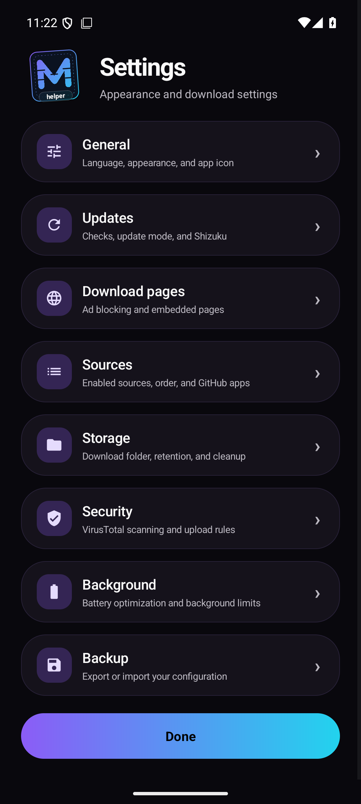
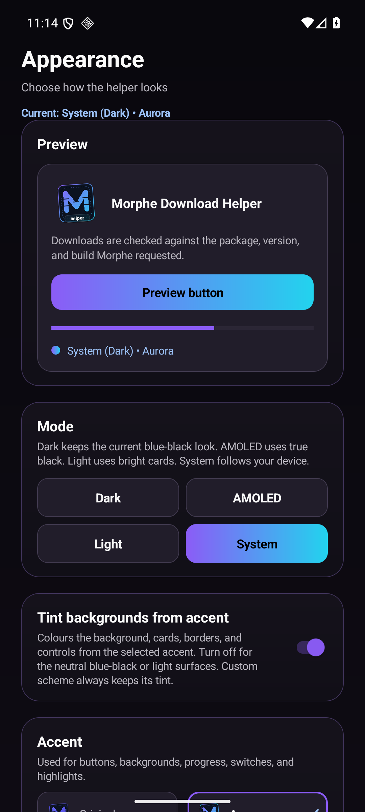
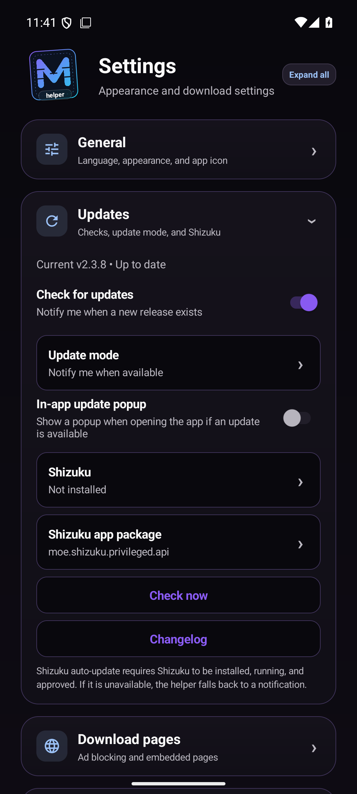
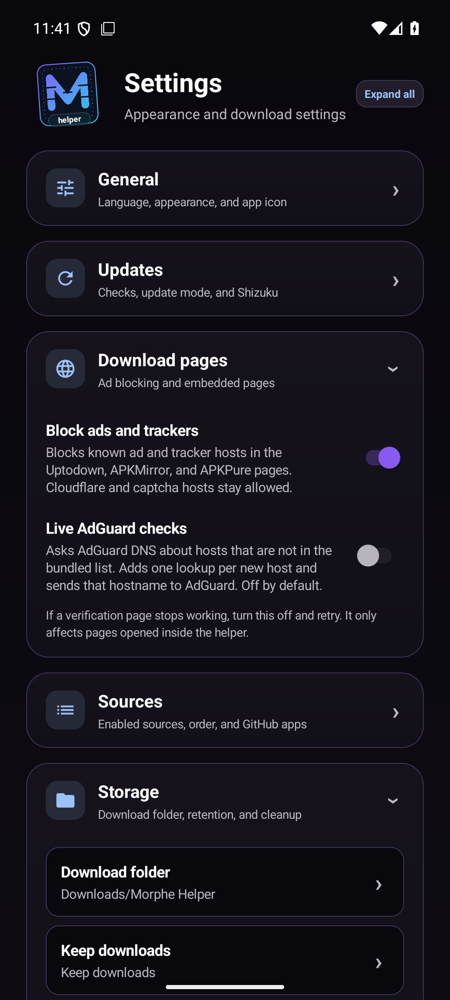
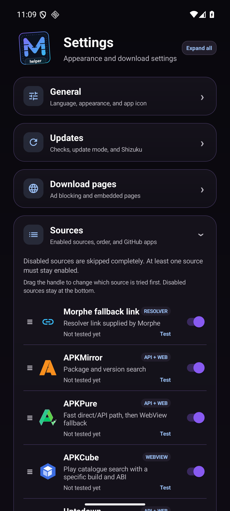
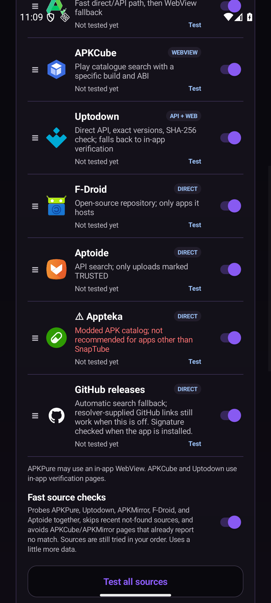
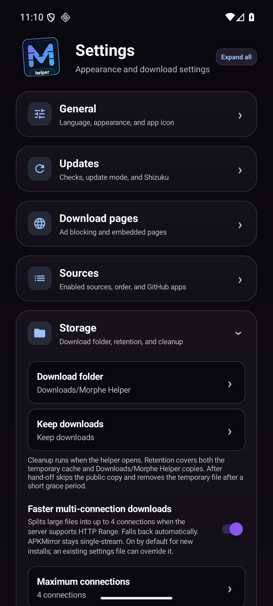
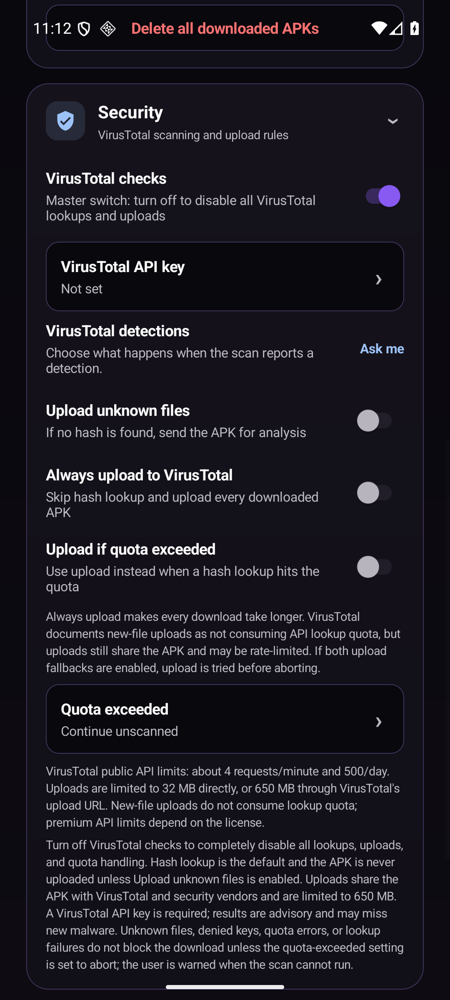
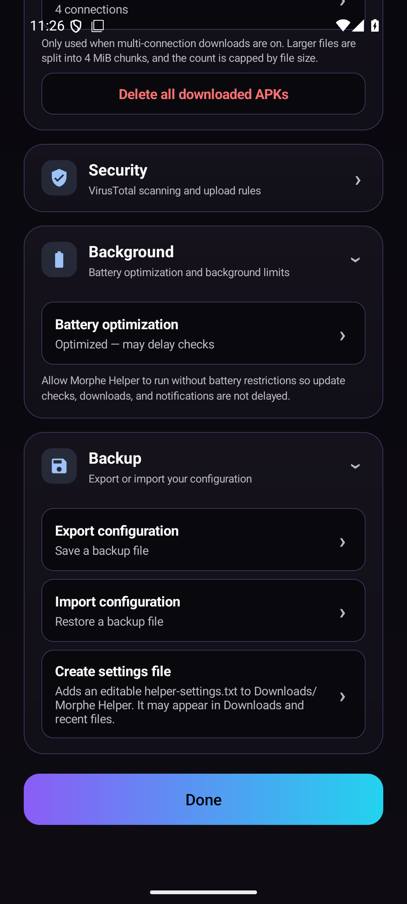

# Settings guide

This page explains every section of **Settings** in Morphe Download Helper 2.6.0. The
section screenshots below were taken from 2.3.10 and show the same options; in 2.5.0 the
sections open in a bottom sheet instead of expanding inline.

Open Settings from the gear button on the main screen. Tap a section to open its options
in a sheet; use the close button or Back to return to the section list.

## General

The **General** section contains the settings that affect the whole app.

| Setting | What it does |
| --- | --- |
| **App language** | Follow the system language or force English/French. In-app language selection requires Android 13 or newer. |
| **Appearance** | Opens the theme and accent editor. |
| **App icon** | Read-only. It shows whether this build always shows the launcher icon (**Icon**) or always hides it (**No-icon**). |

The launcher behavior is fixed per build. There is no hide/show toggle that can leave a
synthetic shortcut behind on Android 10+.

## Appearance

| Setting | What it does |
| --- | --- |
| **Mode** | **Dark** uses the blue-black palette, **AMOLED** uses true black, **Light** uses bright cards, and **System** follows the device. |
| **Tint backgrounds from accent** | Colors the background, cards, borders, and controls from the selected accent. Turn it off for neutral surfaces. A custom scheme always keeps its tint. |
| **Accent** | Sets the color used by buttons, progress, switches, highlights, and the preview. Eleven color presets are included, plus a custom color scheme and, on Android 12+, Material You. |
| **Reset appearance** | Returns to System mode with the Aurora accent. |

## Updates

The **Updates** section controls the helper's own updater, not app downloads.

| Setting | What it does |
| --- | --- |
| **Check for updates** | Enables or disables update checks. |
| **Update mode** | **Notify me when available** shows a notification; **Automatically update via Shizuku** installs silently when Shizuku is available and approved. Without Shizuku it falls back to a notification. |
| **In-app update popup** | Shows a popup with the changelog when an update is available. |
| **Shizuku** | Shows whether Shizuku is installed and running. Tap it to request permission for silent updates. |
| **Shizuku app package** | Only needed for a Shizuku fork with a different package name. Leave blank for the official app or a fork that keeps its package. |
| **Check now** | Runs a check immediately. |
| **Changelog** | Opens the release notes. |

## Download pages

These options affect the in-app WebView pages used for source verification.

| Setting | What it does |
| --- | --- |
| **Block ads and trackers** | Blocks known ad and tracker hosts inside the helper's pages. Cloudflare and captcha hosts stay allowed so verification can still work. |
| **Live AdGuard checks** | For hosts not in the bundled list, asks AdGuard DNS whether to block them. This sends the hostname to AdGuard. Off by default. |

If a verification page stops working, turn **Block ads and trackers** off and retry. This only
affects pages opened inside the helper, not your browser.

## Sources

Sources are tried from top to bottom. Drag the handle to reorder them; use the switch to
enable or disable one. Disabled sources are skipped completely, and at least one source must
stay enabled. Each row has a **Test** action, and **Test all sources** checks the whole list.

| Source | Notes |
| --- | --- |
| **Morphe fallback link** | The exact resolver/fallback link supplied by Morphe. |
| **APKMirror** | Package/version search, Play package verification, and ABI-aware variants. |
| **APKPure** | Exact version-code API and direct endpoints; supports APK and split archives. |
| **APKCube** | Play catalogue search with a background no-match preflight and WebView fallback. |
| **Uptodown** | Direct API with exact versions and SHA-256, then the verification page if needed. |
| **F-Droid** | The F-Droid package API; only apps hosted by F-Droid. |
| **Aptoide** | API search; only uploads marked **TRUSTED**. |
| **Appteka** | Exact version/code; SnapTube only by default and marked hazardous. |
| **GitHub releases** | Resolver links and remembered/pinned repositories first; automatic search is the final fallback. |

### Fast source checks

**Fast source checks** is the main performance switch for source resolution. When on, it:

- probes APKPure, Uptodown, APKMirror, F-Droid, and Aptoide metadata together,
- checks APKCube's page before opening its WebView,
- rejects unrelated APKMirror results before loading their page,
- races APKPure's API and direct endpoints.

Sources are still tried **in your order**. The first valid source wins.

Two caches work independently of this switch:

- The **validated local cache** serves exact repeat requests after rechecking
  package/version/build.
- The **negative cache** skips sources that recently returned a definitive “not found”
  (404/no matching app) for two hours. Timeouts, 403/429, and Cloudflare challenges are not
  cached.

**Retry all sources** and **Retry failed sources** bypass both caches. Turn Fast source checks
off if you want strictly sequential checking with no prefetching. It is independent of
**Faster multi-connection downloads**, which affects the download itself, not source selection.

### GitHub apps

A GitHub apps mapping pins a repository to one package. Use it when an app is distributed only
through GitHub or when automatic search picks the wrong repository.

- **Add GitHub app** — enter the package name, repository (`owner/repo`), an optional asset
  filter, and whether to try it before the normal source order.
- **Try this repo first** — runs the pinned mapping before the Morphe link.
- **Import Obtainium/ObtainX** — imports GitHub entries from an Obtainium or ObtainX JSON
  export. Other source types in the export are skipped.
- **Clear imported sources** — removes all manually imported mappings at once. Built-in
  sources and automatically remembered mappings are kept; the action asks for confirmation.
- **Share** — shares the mapping as text.

The GitHub apps section is collapsed by default. Expand it to see imported mappings; the
count next to the title shows how many mappings exist.

You are responsible for the repositories you add. The helper still validates the APK's
package, version, and build code before hand-off.

## Storage

| Setting | What it does |
| --- | --- |
| **Download folder** | **Downloads/Morphe Helper** (default), **Internal app cache**, **App external storage**, or a custom folder. The hand-off to Morphe works regardless; this controls the convenience copy. |
| **Keep downloads** | **Keep downloads**, **After hand-off**, **Delete after 1 hour**, **Delete after 24 hours**, or **Delete after 7 days**. Retention covers both the temporary cache and public copies. |
| **Faster multi-connection downloads** | Splits large files into up to four connections when the server supports HTTP Range. On by default for new installs. APKMirror stays single-stream; unsupported servers fall back automatically. |
| **Maximum connections** | 2, 4, 8, 16, or 32. The actual count is capped by file size and the 4 MiB chunk size. |
| **Delete all downloaded APKs** | Removes cached downloads and public/custom copies. It also clears the local-cache index. Settings files are preserved. |

> **Why is multi-connection off on my phone?** An existing `helper-settings.txt` may contain
> `multi_thread_downloads=false`. That value overrides the new default. Toggle the switch on,
> delete the settings file, or edit the value to `true`.

## Security

VirusTotal is optional and **off by default**.

| Setting | What it does |
| --- | --- |
| **VirusTotal checks** | Master switch. Off disables all lookups, uploads, and quota handling. |
| **VirusTotal API key** | Stored only on this device. A key is required before scanning can run. |
| **VirusTotal detections** | **Ask me**, **Always block**, or **Always continue** when a scan reports a detection. |
| **Upload unknown files** | If no hash is found, send the APK to VirusTotal for analysis. This shares the APK with VirusTotal. |
| **Always upload to VirusTotal** | Skips the hash lookup and uploads every downloaded APK. Slower and shares every file. |
| **Upload if quota exceeded** | Uses an upload instead of aborting when a hash lookup hits the API quota. |
| **Quota exceeded** | **Continue unscanned** or **Abort handoff** when the lookup quota is exhausted. |

Hash lookup is the default. The APK is never uploaded unless one of the upload options is
enabled. Results are advisory and may miss new malware. VirusTotal failures do not block a
download unless you choose to abort on quota. See the note in the app for current public API
limits.

## Background

**Battery optimization** shows whether Android is restricting the helper. Request an
exemption so update checks, downloads, and notifications are not delayed. This is optional;
the helper still works while optimized, but Android may delay background work.

## Backup

| Setting | What it does |
| --- | --- |
| **Export configuration** | Saves a settings backup. Choose settings only or include the VirusTotal API key in plain text. |
| **Import configuration** | Replaces the current settings with a selected backup. User-added GitHub app mappings are replaced by the mappings in the file. |
| **Create settings file** | Creates the optional `Downloads/Morphe Helper/helper-settings.txt` and keeps it in sync with Settings. |
| **Delete settings file** | Stops syncing and removes all `helper-settings` copies from Downloads. Your current in-app settings stay unchanged. |

`helper-settings.txt` is **not created automatically** anymore. New installs stay file-free,
so it does not appear in Downloads or recent files. If you delete it, it will not be recreated
unless you tap **Create settings file** again.

## Quick answers

- **Fast source checks vs. multi-connection:** Fast source checks affects how sources are
  searched. Multi-connection affects the download transfer after a file is found.
- **Why did a source say “Skipped”?** Either it is disabled, it was recently found not to
  have the app (negative cache), or GitHub automatic search needs a version. The report shows
  the reason.
- **Why is the GitHub row skipped?** Automatic GitHub search needs a version. Remembered and
  pinned repositories are still tried.
- **How do I force a fresh search?** Tap **Retry all sources** or **Retry failed sources**.
  Both bypass the local result caches.
- **How do I remove the old settings file?** Settings → Backup → **Delete settings file**.
- **Where is the log?** Main screen → **Helper log** → **Share log**, **Save log**,
  **Copy log**, or **Report on GitHub**.

Back to the [main README](../README.md) or the [setup guide](../GUIDE.md).
